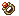

  <h1>
    
    Essentialis
  </h1>
  <h3>A growing collection of special weapons, tools and trinkets.</h3>

## About this mod
**Essentialis** is a Fabric mod that adds unique items to Minecraft. Some of them are completely new, some were created by other people (check credits below) but we rewritten them to be native java mod (+ optimized).

The current items are the **Echo Chakram** (a faithful native port of the popular
[*Chakram*](https://modrinth.com/datapack/chakram) data pack by maybejake & evergreenavery), the
**Hammer** (a combined iron pickaxe/shovel that mines in a 3x3) and the **Wayback Stone** (a
death-saving charm with a teleport home).

## The Echo Chakram
 A mid-range throwing weapon crafted from echo shards and a breeze rod. **Right click** to throw the
chakram: it flies out, spins, bounces off terrain and returns to your hand.

- Repairable with **echo shards**.
- Ramps off walls to build reach (up to 10 bounces per throw, each rewarded by Ricochet).
- Can be thrown from either hand and returns to the hand it was thrown from.
- Special interactions: cuts down crops with Harvesting, makes Endermen blink away, and triggers
  target blocks on impact.
- Comes with few new enchantments:

| Enchantment | Max level | Effect |
| --- | --- | --- |
| **Bouncing** | 3 | After hitting an enemy, the chakram ricochets toward another nearby, visible enemy instead of returning. Mutually exclusive with Phasing. |
| **Harvesting** | 1 | Destroys crops, flowers and other foliage the chakram flies through. |
| **Lightweight** | 3 | Increases the chakram's maximum flight range by 7.5 blocks per level. |
| **Phasing** | 5 | Lets the chakram pass through enemies (up to one per level) instead of returning on impact. Mutually exclusive with Bouncing. |
| **Ricochet** | 5 | Adds bonus damage for every wall the chakram has bounced off. Mutually exclusive with Sharpness, Smite and Bane of Arthropods. |
| **Scavenger** | 1 | Picks up items the chakram flies past and brings them back to you. |

The enchantments can be found on enchanted books in **ancient city** chests (or applied at an
enchanting table, as chakram is a sword-class weapon).

## The Hammer
 A heavy mining tool that works as a combination of **iron pickaxe** and **iron shovel** - breaking a
**3x3 area** with every swing.

- Same mining speed and stats as an iron pickaxe.
- Repairable with **iron blocks**.
- Supports the same enchantments as iron pickaxes and shovels (Efficiency, Fortune, Silk Touch, ...).
- Supports UI highlight for blocks before breaking them.

## The Wayback Stone
 A charm that cheats death. When player is about to die, it leaves them on **one heart** and
teleports to respawn point.

- Works from a trinket **ring slot** (with Trinkets Updated installed) or from either hand.
- Has 15 minute use cooldown. Stone itself is never consumed.
- Also grants 30 seconds of fire resistance.

## Rings
Trinkets with no durability. Work from a trinket **ring slot** (with Trinkets Updated installed) or
from either hand. Effects from multiple rings stack. Netherite versions are upgraded in a
**smithing table** (ring + netherite ingot + upgrade template).

-  **Citrine Ring** - highlights enemies within **16 blocks** (red outline). Netherite: **32 blocks**
  and ignites undead within 16 blocks. Rare loot (3%): mineshafts, outposts, mansions, suspicious sand/gravel.
-  **Jade Ring** - **+10%** movement speed and jump height. Netherite: doubled, also works while
  riding. Rare loot (2%): chests and barrels everywhere.
-  **Ruby Ring** - heals **5%** of the damage you deal. Netherite: doubled. Rare loot (2%): nether
  fortresses and bastions. Rare loot (3%): suspicious sand/gravel.
-  **Sapphire Ring** - **25%** shorter burn time, **+25%** speed in water and lava. Netherite: +50%
  speed and longer breath. Rare loot (2%): ocean ruins, shipwrecks. Rare loot (3%): suspicious sand/gravel. Rare loot (1%): drowned kills.
-  **Tanzanite Ring** - doubles the duration of **any** effect on you. Netherite: positive effects
  only. Rare loot (2%): witch and illager kills.
-  **Topaz Ring** - **+1** Luck. Netherite: +2 Luck and fortuitous finds (extra diamonds from lapis
  and emerald ores, bonus harvests, trophies from slain foes, lucky catches and luckier chests). Rare
  loot (2%): chests and barrels everywhere.

## Compatibility
- [Trinkets Updated](https://modrinth.com/mod/trinkets-updated): the Wayback Stone can be worn in a ring slot.
- [Penchant](https://modrinth.com/mod/penchant) (0.5.7+): chakram enchantments level up through use, like vanilla ones.

## Credits
- Original *Chakram* data pack concept and assets by **maybejake** and **evergreenavery**
  (MIT licensed). The chakram texture/icon come from that project.
- Original *Wayback Stone* data pack / mod concept and assets by **DarkhaxDev**
  (GNU Lesser General Public licensed). The stone texture come from that project.
- Native Fabric implementation by **Amatsagu**.

> [!Note]
> Some of the datapack -> java code transpilation was handled with help of artificial intelligence. This mod can be viewed publicly so clients running Essentia 2 Modpack can properly resolve files & check for updates. This mod can be launched standalone but it was prepared with this modpack in mind.

## License
All Rights Reserved with exception of elements taken directly from credited works.
